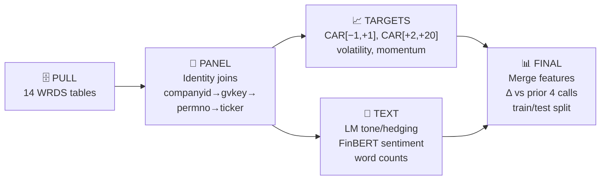
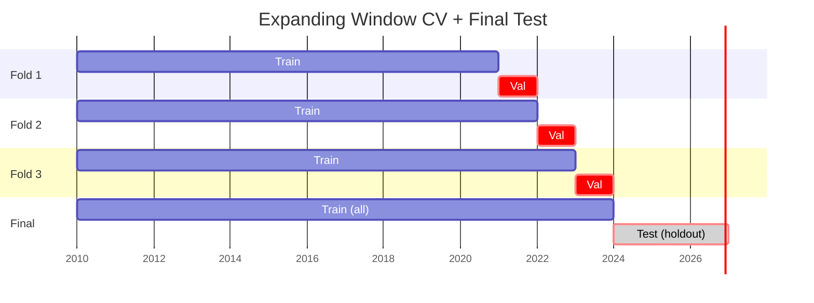
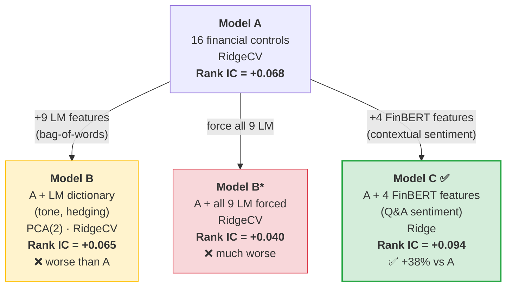
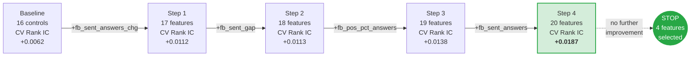

# linguistic-alpha

Research pipeline: do earnings-call language features predict S&P 500 post-call drift,
CAR[+2,+20] and other horizons, beyond the earnings surprise and standard controls?
Data comes from WRDS: Capital IQ transcripts, CRSP, Compustat and I/B/E/S.

- Architecture and stage contracts: [docs/pipeline.md](docs/pipeline.md)
- Legacy notebook audit and rebuild plan: [docs/data_audit.md](docs/data_audit.md)
- Run settings: [configs/default.yaml](configs/default.yaml)
- Pipeline data reference (WRDS tables): [docs/tables-reference.html](docs/tables-reference.html)
- Pipeline flow diagram: [docs/pipeline-diagram.html](docs/pipeline-diagram.html)

## S&P 500 Pipeline (GCP)

A standalone pipeline ([`sp500_pipeline.py`](sp500_pipeline.py)) pulls all WRDS source data, builds date-validated
identifier links, computes abnormal returns and controls, extracts NLP features from Capital IQ
transcripts, and produces a single modeling table — one row per earnings call.

### Dataset summary

| Metric | Value |
|--------|-------|
| Total earnings calls | 29,698 |
| Calls with CAR[+2,+20] | 26,314 |
| Calls with SUE | 27,744 |
| Date range | 2010-01-06 to 2026-10-30 |
| GICS sectors | 11 |
| Train sample | 2010–2021 |
| Test sample | 2022–2024 |

### Results at a glance

All models use GradientBoosting (best by Rank IC). Train 2010–2021 (expanding-window CV), test 2022–2024.

| | Model A (controls only) | Model B (rank filter) | Model B** (forward sel.) | Model B* (all forced) | Model C (FinBERT selected) | Model C* (all FinBERT forced) |
|---|---|---|---|---|---|---|
| **Features** | 12 controls | 11 ctrl + 2 ling | 12 ctrl + 0 ling | 11 ctrl + 9 ling | 12 ctrl + 0 FinBERT | 12 ctrl + 13 FinBERT |
| **CV Rank IC** | **+0.038** | +0.033 | **+0.038** | +0.024 | **+0.038** | +0.026 |
| **Test Rank IC** | **+0.047** | +0.038 | **+0.047** | +0.043 | **+0.047** | +0.032 |
| **Test Q5−Q1 spread** | **+0.67%** | +0.61% | **+0.67%** | +0.78% | **+0.67%** | +0.45% |

**Finding:** Neither LM dictionary features (Model B) nor FinBERT contextual sentiment (Model C) improve prediction — Model A (no linguistics) leads on CV Rank IC. Two feature selection methods were tried for LM features: rank-based filtering (Model B, selected 2 linguistic) and forward selection (Model B**, selected 0 linguistic). Both confirm linguistic features don't help on the full S&P 500. Forward selection added zero FinBERT features (Model C) as well; forcing all features (B*, C*) degraded performance. See [full comparison](#model-comparison-all-variants).

### Output files

| File | Description |
|------|-------------|
| [`model_table.csv`](model_table.csv) | One row per call (45 cols): IDs, sector, Day 0, CAR targets, controls, sample split (no linguistic) |
| [`model_table_with_linguistic.csv`](model_table_with_linguistic.csv) | Full table (54 cols): everything in model_table + LM tone, hedging, uncertainty, deltas |
| [`data_report.txt`](data_report.txt) | Summary statistics, coverage by year, missing values, validation checks |
| [`model_a_report.txt`](model_a_report.txt) | Model A baseline report: preprocessing, feature selection, CV and test results |
| [`model_a_results.json`](model_a_results.json) | Machine-readable Model A results (metrics, selected features, config) |
| [`model_b_report.txt`](model_b_report.txt) | Model B report: feature selection, CV results, A vs B comparison |
| [`model_b_results.json`](model_b_results.json) | Machine-readable Model B results |
| [`model_b_all_report.txt`](model_b_all_report.txt) | Model B* report: all-features CV results, 3-way comparison |
| [`model_b_all_results.json`](model_b_all_results.json) | Machine-readable Model B* results |
| [`model_c_report.txt`](model_c_report.txt) | Model C report: forward selection log, CV and test results |
| [`model_c_results.json`](model_c_results.json) | Machine-readable Model C results |
| [`model_c_all_report.txt`](model_c_all_report.txt) | Model C* report: all 13 FinBERT features forced |
| [`model_c_all_results.json`](model_c_all_results.json) | Machine-readable Model C* results |
| [`model_b_forward_report.txt`](model_b_forward_report.txt) | Model B** report: forward selection log, test results |
| [`model_b_forward_results.json`](model_b_forward_results.json) | Machine-readable Model B** results |
| [`sp500_pipeline.py`](sp500_pipeline.py) | Main pipeline: PULL → PANEL → TARGETS → TEXT → FINAL |

### Column reference ([`model_table.csv`](model_table.csv))

| Column(s) | Category | Description |
|-----------|----------|-------------|
| `keydevid`, `transcriptid`, `companyid` | IDs | Capital IQ event and transcript identifiers |
| `companyname`, `ticker`, `gvkey`, `permno` | IDs | Company name, ticker, Compustat and CRSP identifiers |
| `call_date`, `call_time_utc`, `headline` | Call metadata | Earnings call date, UTC time, and headline |
| `sector`, `gind`, `sic` | Industry | GICS sector name, GICS industry code, SIC code |
| `day0` | Timing | First trading day after the call date (event day 0) |
| `car_0_1` | Target | Cumulative abnormal return, day 0–1 (announcement return) |
| `car_2_5` | Target | CAR day 2–5 (short-term drift) |
| **`car_2_20`** | **Target** | **CAR day 2–20 (primary target — post-earnings drift)** |
| `car_2_60` | Target | CAR day 2–60 (long-term drift) |
| `vol_post_2_20` | Target | Post-call realized volatility, day 2–20 |
| `vol_pre` | Control | Pre-call realized volatility (20 trading days before) |
| `mcap_m`, `size` | Control | Market cap ($M) and log market cap |
| `mom` | Control | 12-1 month momentum |
| `bm` | Control | Book-to-market ratio |
| `fiscal_period_end` | Control | Fiscal quarter end date |
| `actual_eps`, `consensus_eps`, `eps_surprise` | Earnings | Actual EPS, I/B/E/S consensus, and surprise |
| `sue`, `sue_price`, `surprise_pct` | Earnings | Standardized Unexpected Earnings, SUE/price, surprise % |
| `n_analysts`, `dispersion` | Analyst | Number of covering analysts, forecast dispersion |
| `split_adjusted_consensus` | Analyst | Whether consensus was split-adjusted |
| `n_questions`, `n_answers` | Call structure | Number of Q&A questions and answers |
| `words_prepared`, `words_answers`, `words_questions` | Call structure | Word counts by section |
| `avg_answer_words` | Call structure | Average words per executive answer |
| `share_other_sections`, `share_answers_by_execs` | Call structure | Share of non-QA text; exec participation in answers |
| `tone_prepared`, `tone_answers` | Linguistic | LM net tone: (positive − negative) / (positive + negative) per 1k words |
| `hedging_prepared`, `hedging_answers` | Linguistic | LM weak-modal (hedging) words per 1k words |
| `uncertainty_answers` | Linguistic | LM uncertainty words per 1k words in Q&A answers |
| `tone_gap` | Linguistic | `tone_answers` − `tone_prepared` (shift from script to Q&A) |
| `tone_prepared_chg`, `tone_answers_chg` | Linguistic | Change in tone vs. prior 4-call average |
| `hedging_answers_chg` | Linguistic | Change in hedging vs. prior 4-call average |
| `period` | Split | Fiscal period label |
| `sample` | Split | `train` (2010–2021), `test` (2022–2024), or `no_target` (2025–2026). |
| `prior_calls_with_target` | Meta | Count of prior calls for same firm with realized CAR |

### Pipeline stages



| Stage | What it does |
|-------|-------------|
| **PULL** | Download 14 WRDS tables (CRSP, Compustat, I/B/E/S, Capital IQ transcripts) |
| **PANEL** | Chain date-validated identity joins: companyid → gvkey → permno → IBES ticker → GICS sector |
| **TARGETS** | Compute CAR[−1,+1], CAR[+2,+5], CAR[+2,+20] (primary), CAR[+2,+60], post-call volatility |
| **TEXT** | Extract NLP features: tone ([Loughran-McDonald dictionary](data/Loughran-McDonald_MasterDictionary_1993-2025.csv)), hedging, FinBERT sentiment, word counts |
| **FINAL** | Merge numeric + language features, compute deltas vs. prior 4 calls, assign sample split |

### Identity join chain (PANEL stage)

All joins are date-validated inner joins (left join for I/B/E/S ticker and sector).
Each step requires the link to be active on the earnings-call date.

```
Capital IQ transcripts          Compustat / CRSP             I/B/E/S
─────────────────────          ──────────────────           ─────────
 companyid                       gvkey                       ticker
 keydevid (call)                 permno
 call_date                       linkdt–linkenddt

         ┌──────────────────────────────────────────────┐
         │  CIQ calls                                   │
         │  (companyid, keydevid, call_date)             │
         └──────────┬───────────────────────────────────┘
                    │  inner join on companyid
                    │  link: ciq.wrds_gvkey (date-valid)
                    ▼
         ┌──────────────────────────────────────────────┐
         │  + gvkey                                     │
         └──────────┬───────────────────────────────────┘
                    │  inner join on gvkey
                    │  link: crsp.ccmxpf_lnkhist (date-valid, primary)
                    ▼
         ┌──────────────────────────────────────────────┐
         │  + permno                                    │
         └──────────┬───────────────────────────────────┘
                    │  inner join on permno
                    │  filter: S&P 500 member on call_date
                    ▼
         ┌──────────────────────────────────────────────┐
         │  + S&P 500 membership confirmed              │
         └──────────┬───────────────────────────────────┘
                    │  left join on permno
                    │  link: wrdsapps.ibcrsphist (date-valid, best score)
                    ▼
         ┌──────────────────────────────────────────────┐
         │  + IBES ticker  (missing → no SUE/surprise)  │
         └──────────┬───────────────────────────────────┘
                    │  left join on gvkey
                    │  source: comp.company
                    ▼
         ┌──────────────────────────────────────────────┐
         │  event_panel.parquet                         │
         │  (keydevid, companyid, gvkey, permno,        │
         │   ticker, sector, call_date)                 │
         └──────────────────────────────────────────────┘
```

Calls that fail any inner join are dropped — primarily firms not in the S&P 500 on the call date or with no valid CCM link. The I/B/E/S ticker is a left join: calls without a ticker match remain but will have missing SUE and surprise features downstream.

**Day 0 definition:** Always the next trading day after the call date. This ensures the market has had the full earnings call before Day 0 opens, giving a clean post-call baseline for all CAR windows.

### WRDS tables → features

| WRDS Table | What it provides | Features derived |
|------------|-----------------|-----------------|
| `ciq.ciqtranscript` + `ciq.ciqtranscriptcomponent` | Earnings call transcripts (prepared remarks, Q&A) | `words_prepared`, `words_answers`, `n_questions`, `n_answers`, `share_answers_by_execs`, all tone/hedging/uncertainty features |
| `crsp.dsf` (daily stock file) | Daily returns, prices, shares outstanding | `car_0_1`, `car_2_5`, `car_2_20`, `car_2_60`, `vol_pre`, `mom`, `size` |
| `crsp.dsedelist` | Delisting returns | Folded into CAR to correct survivorship bias |
| `crsp.msp500list` | S&P 500 membership spells | Universe filter — call must be during membership |
| `comp.fundq` | Quarterly fundamentals (book equity) | `bm` (book-to-market) |
| `comp.company` | Company identifiers, GICS sector | `sector`, `gind`, `sic` |
| `ibes.actu_epsus` | Actual EPS (unadjusted) | `sue`, `sue_price`, `surprise_pct` |
| `ibes.statsumu_epsus` | Consensus EPS forecasts | `sue`, `sue_price`, `surprise_pct`, `dispersion`, `n_analysts` |
| `crsp.ccmxpf_lnkhist` | gvkey ↔ permno link | Identity join (PANEL stage) |
| `wrdsapps.ibcrsphist` | permno ↔ IBES ticker link | Identity join (PANEL stage) |
| `ciq.wrds_gvkey` | companyid ↔ gvkey link | Identity join (PANEL stage) |
| `crsp.dsi` + Fama-French factors | Market index returns, risk factors | Abnormal returns (market-adjusted) |

### How to run

```bash
# Step 0: Extract SP500 data (GCP VM, e2-standard-8, 32GB RAM; interactive WRDS login, Duo required)
pip install -r requirements.txt
python3 sp500_pipeline.py
python3 sp500_pipeline.py --stages panel targets text final   # rebuild from cached raw data

# Steps 1-4 take --sector {it,health,comm} (GICS 45 / 35 / 50) and work in ~/earnings_{sector}
# Step 1: Extract the sector subsample and compute its sector benchmark
python3 sector_extract.py --sector it --folder ~/earnings_sp500

# Step 2: Run Model A + Model B (6 strategies + B*)
python3 sector_model_b.py --sector it

# Step 3: Extract FinBERT features (requires GPU VM)
python3 sector_finbert_features.py --sector it --sp500-folder ~/earnings_sp500

# Step 4: Run Model C (FinBERT strategies)
python3 sector_model_c_finbert.py --sector it
```

Sector membership uses today's Compustat GICS sector (`gsector`) applied to the whole history, not point-in-time. Sector definitions live in [`sector_config.py`](sector_config.py); to add a sector, add one entry there. Output files are prefixed with the sector key (e.g. `health_model_b_improved_*`). The existing IT results in `it_results/` were produced by the earlier `it_*` scripts and are unchanged.

| Script | Purpose |
|--------|---------|
| [`sp500_pipeline.py`](sp500_pipeline.py) | PULL → PANEL → TARGETS → TEXT → FINAL for the full S&P 500 |
| [`sector_config.py`](sector_config.py) | Sector definitions (GICS code, name, output folder) |
| [`sector_extract.py`](sector_extract.py) | Sector subsample and sector value-weighted benchmark |
| [`sector_model_b.py`](sector_model_b.py) | Model A + Model B (6 strategies + B*) |
| [`sector_finbert_features.py`](sector_finbert_features.py) | FinBERT sentence-level features (GPU, ProsusAI/finbert) |
| [`sector_model_c_finbert.py`](sector_model_c_finbert.py) | Model C (FinBERT strategies) |

The scripts that produced the full-S&P 500 Model A/B/C results below (Model A, B, B*, B**, C/C*, and the original FinBERT extraction) are archived in [`old_models/`](old_models/). Their reports and JSON outputs remain in the repo root.

#### FinBERT inputs

FinBERT scoring (~2.7M sentences) needs a GPU (~220 sentences/sec on a T4). The TEXT stage of `sp500_pipeline.py` writes per-year `text/text_{year}.parquet` with `transcriptid`, `prepared_text` and `qa_text`; `sector_finbert_features.py` reads them via `--sp500-folder` and writes `finbert_features.parquet`. Each sentence is classified positive/negative/neutral with [ProsusAI/finbert](https://huggingface.co/ProsusAI/finbert) and aggregated into 13 per-call features.

**Required input files for FinBERT extraction:**

| File | Source | Description |
|------|--------|-------------|
| `text/text_{year}.parquet` (×17) | `sp500_pipeline.py` TEXT stage | Transcript text per year (prepared remarks + Q&A) |
| `event_panel.parquet` | `sp500_pipeline.py` PANEL stage | Call metadata with `transcriptid`, `permno`, `call_date` (for YoY deltas) |

**Required input files for Model C training:**

| File | Source | Description |
|------|--------|-------------|
| `model_table.parquet` | `sp500_pipeline.py` FINAL stage | Full modeling table (controls, targets, identifiers) |
| `finbert_features.parquet` | `sector_finbert_features.py` | FinBERT sentiment features (13 per call) |

## Model A Baseline (No Linguistic Features)

Predicts CAR[+2,+20] using only financial controls and call structure — no sentiment or tone features.
Train: 2010–2021 (expanding-window CV) | Test: 2022–2024 (one-time evaluation)
Script: [`old_models/model_a_baseline.py`](old_models/model_a_baseline.py) | Report: [`model_a_report.txt`](model_a_report.txt) | JSON: [`model_a_results.json`](model_a_results.json)

### Feature descriptions (Model A — 18 candidates, 12 selected)

**Earnings surprise features** — the core driver of post-earnings drift (PEAD). Firms that beat expectations tend to keep drifting up, and misses keep drifting down.

| Feature | What it measures | Why it matters for drift |
|---------|-----------------|------------------------|
| `sue` | Standardized Unexpected Earnings: (actual − consensus) / std dev of past surprises | The classic PEAD signal — higher SUE → stronger positive drift. Standardizing by historical dispersion makes surprises comparable across firms. |
| `sue_price` | Earnings surprise scaled by stock price | Controls for price level — a $0.05 surprise means more for a $10 stock than a $500 stock. Reduces the influence of high-priced, low-volatility names. |
| `surprise_pct` | (actual − consensus) / consensus as a percentage | Raw percentage surprise. Dropped by feature selection (rank 11.3) — `sue` and `sue_price` capture the same information better. |
| `share_answers_by_execs` | Share of Q&A answers given by executives (vs. IR, etc.) | Selected (rank 12.0). Captures management engagement — firms where executives personally answer more questions may be signaling confidence. |

**Firm characteristics** — known cross-sectional return predictors (Fama-French factors and related).

| Feature | What it measures | Why it matters for drift |
|---------|-----------------|------------------------|
| `size` | Log market capitalization on the day before the call | Small firms have stronger PEAD — less analyst coverage, slower information diffusion. The size effect is one of the most robust findings in PEAD literature. |
| `bm` | Book-to-market ratio (Compustat book equity / CRSP market cap) | Value stocks (high B/M) may have different drift patterns. Controls for the value factor so the model doesn't confuse drift with value premium. |
| `mom` | 12-month minus 1-month momentum (cumulative return) | Firms with strong prior momentum may have continuation or reversal patterns that interact with earnings surprises. Highest RF importance (0.146) — tree models find nonlinear interactions with other features. |
| `vol_pre` | Realized volatility over 20 trading days before the call | High pre-call volatility means more uncertainty. Highest single-feature RF importance (0.296) — the model uses it to scale expected drift magnitude. |

**Analyst coverage** — captures the information environment around the firm.

| Feature | What it measures | Why it matters for drift |
|---------|-----------------|------------------------|
| `dispersion` | Standard deviation of analyst EPS forecasts / abs(consensus) | **Strongest univariate signal** (Spearman p < 0.001). High disagreement = high uncertainty = more room for the market to slowly digest the surprise. Firms with high dispersion show stronger, more persistent drift. |
| `n_analysts` | Number of analysts covering the firm | More coverage → faster price discovery → weaker drift. Dropped by feature selection (rank 13.7) — correlated with `size`. |

**Call structure** — measures what happened during the earnings call itself.

| Feature | What it measures | Why it matters for drift |
|---------|-----------------|------------------------|
| `car_0_1` | Announcement-day return (CAR day 0–1) | The initial market reaction. Known at the start of the drift window — strong announcement returns may predict continuation (underreaction) or reversal. |
| `words_answers` | Total word count in Q&A answers (log-transformed) | Longer answers may signal more complex or ambiguous situations. Selected (rank 11.7) — Spearman correlation (p = 0.028) and RF importance both picked it up. |
| `n_answers` | Number of Q&A answers | More Q&A exchanges can indicate higher analyst interest or management willingness to engage. Selected (rank 12.3) — Spearman significant (p = 0.003). |
| `n_questions` | Number of analyst questions in Q&A | Dropped (rank 13.3) — correlated with `n_answers`. |
| `words_prepared` | Word count in prepared remarks (log-transformed) | Dropped (rank 13.7) — length of the scripted section has low predictive value. |
| `words_questions` | Word count in analyst questions (log-transformed) | Dropped (rank 13.7). |
| `avg_answer_words` | Average words per executive answer (log-transformed) | Dropped (rank 13.7) — collinear with `words_answers`. |

**Other:**

| Feature | What it measures | Why it matters for drift |
|---------|-----------------|------------------------|
| `prior_calls_with_target` | How many prior earnings calls this firm has with realized CAR | Controls for data availability — firms with more history have more stable feature estimates. Also captures a survivorship/tenure effect. |

### Preprocessing

- **Winsorization** at 1st/99th percentile (fit on train per CV fold, no leakage)
- **Log-transform** right-skewed features: `words_prepared`, `words_answers`, `words_questions`, `avg_answer_words`, `n_analysts`
- **Median imputation** for missing values (per fold)
- **VIF multicollinearity check** — flagged `n_answers` (15.9), `avg_answer_words` (12.3), `words_answers` (11.8)
- **StandardScaler** per fold
- **Sector one-hot encoding** (drop first)
- **Time-series expanding window CV** on train (2010–2021), no future leakage
- **Test set** (2022–2024) evaluated once after all model selection decisions

### Feature selection

Three-method ensemble ranking (Spearman \|r\|, Mutual Information, Random Forest importance).

**Feature selection criterion:** Keep features in the top half by average rank across the 3 methods, plus any feature with a significant univariate Spearman correlation (p < 0.05). This selects features that either rank well on multiple measures or have a statistically significant standalone signal.

Selected top 12 of 18 candidate features:

| Feature | Spearman \|r\| | MI | RF Imp | Avg Rank | Selected |
|---------|---------------|------|--------|----------|----------|
| `dispersion` | 0.037 | 0.022 | 0.069 | **2.3** | Yes |
| `size` | 0.024 | 0.014 | 0.040 | **5.0** | Yes |
| `vol_pre` | 0.005 | 0.062 | 0.296 | **5.0** | Yes |
| `mom` | 0.004 | 0.026 | 0.146 | **6.3** | Yes |
| `prior_calls_with_target` | 0.015 | 0.010 | 0.064 | **6.3** | Yes |
| `car_0_1` | 0.009 | 0.015 | 0.054 | **7.0** | Yes |
| `bm` | 0.011 | 0.010 | 0.047 | **8.0** | Yes |
| `sue_price` | 0.003 | 0.014 | 0.068 | **8.7** | Yes |
| `sue` | 0.017 | 0.008 | 0.026 | **9.0** | Yes |
| `words_answers` | 0.014 | 0.000 | 0.023 | **11.7** | Yes |
| `share_answers_by_execs` | 0.015 | 0.001 | 0.002 | **12.0** | Yes |
| `n_answers` | 0.019 | 0.000 | 0.019 | **12.3** | Yes |
| `surprise_pct` | 0.002 | 0.010 | 0.033 | 11.3 | — |
| `n_analysts` | 0.008 | 0.001 | 0.027 | 11.7 | — |
| `n_questions` | 0.010 | 0.000 | 0.019 | 13.3 | — |
| `words_prepared` | 0.011 | 0.000 | 0.020 | 13.7 | — |
| `avg_answer_words` | 0.004 | 0.000 | 0.028 | 13.7 | — |
| `words_questions` | 0.003 | 0.009 | 0.021 | 13.7 | — |

### Cross-validation results

Time-series expanding window CV on train period 2010–2021. All 8 models compared:

| Model | Avg IC | Avg Rank IC | Dir Accuracy | Q5-Q1 Spread |
|-------|--------|-------------|-------------|--------------|
| **GradientBoosting** | **+0.023** | **+0.038** | 0.524 | **+0.92%** |
| RandomForest | +0.036 | +0.033 | 0.527 | +0.70% |
| XGBoost | +0.017 | +0.030 | 0.520 | +0.78% |
| ExtraTrees | +0.030 | +0.019 | 0.528 | +0.20% |
| ElasticNet | +0.010 | −0.007 | 0.518 | −0.42% |
| Ridge / OLS | −0.006 | −0.009 | 0.502 | −0.24% |
| Lasso | +0.021 | −0.013 | 0.529 | −0.59% |

**Best model by Rank IC: GradientBoosting** (avg Rank IC +0.038, Q5-Q1 spread +0.92%)

### Test results (2022–2024)

One-time evaluation of the best CV model (GradientBoosting) on unseen data:

| Metric | Value |
|--------|-------|
| IC | +0.003 |
| Rank IC | **+0.047** |
| R² | −0.044 |
| RMSE | 0.067 |
| Direction accuracy | 51.9% |
| Q5-Q1 spread | +0.67% |

Controls generalize to the test period with positive Rank IC. The question: can linguistic features improve on this?

### Key definitions

| Metric | Definition | Range | Good value |
|--------|-----------|-------|------------|
| **IC** (Information Coefficient) | Pearson correlation between predicted and actual CAR | [−1, +1] | > +0.05 |
| **Rank IC** | Spearman rank correlation — preferred for trading signals | [−1, +1] | > +0.03 |
| **R²** | Variance explained; negative = worse than predicting zero | (−∞, 1] | > 0 |
| **Dir Accuracy** | Share of predictions with correct sign | [0, 1] | > 0.52 |
| **Q5-Q1 Spread** | Mean CAR of top quintile minus bottom quintile | any | > 0 |

**Feature selection criterion:** Top half by average rank across 3 methods (Spearman \|r\|, Mutual Information, Random Forest importance) + any feature with significant univariate Spearman (p < 0.05). Model B uses top 60% instead of top 50% to give linguistic features a fair chance.

## Model B: Controls + Linguistic Features

Adds [Loughran-McDonald dictionary](data/Loughran-McDonald_MasterDictionary_1993-2025.csv) features (tone, hedging, uncertainty) on top of Model A's controls.
Train: 2010–2021 (expanding-window CV) | Test: 2022–2024 (one-time evaluation)
Script: [`old_models/model_b_linguistic.py`](old_models/model_b_linguistic.py) | Report: [`model_b_report.txt`](model_b_report.txt) | JSON: [`model_b_results.json`](model_b_results.json)

### Feature descriptions (Model B — 9 linguistic candidates added to Model A's controls)

All linguistic features are computed using the **[Loughran-McDonald (LM) Master Dictionary](data/Loughran-McDonald_MasterDictionary_1993-2025.csv)** (1993–2025 edition, 86,553 words), a finance-specific word list designed for 10-K/10-Q and earnings call text. Unlike general-purpose sentiment (e.g., Harvard GI), LM classifies words by how they function in financial disclosure — "liability" is negative in general English but neutral in finance.

**Tone features** — measure net sentiment polarity. The hypothesis: managers who use more positive vs. negative words may be signaling genuine confidence (→ positive drift) or spinning bad results (→ reversal).

| Feature | What it measures | Why it might matter | Result |
|---------|-----------------|--------------------| -------|
| `tone_prepared` | (LM positive − LM negative) / (positive + negative) in prepared remarks | Prepared remarks are scripted — tone reflects deliberate framing by IR/legal teams. Optimistic framing of strong results may predict continuation. | Dropped (rank 14.7). Near-zero Spearman and MI — the scripted section's tone is too polished to carry incremental signal. |
| `tone_answers` | Same ratio computed on Q&A answers only | Q&A is live and less rehearsed — executives reveal more under analyst questioning. Tone here is less controlled and potentially more informative. | Dropped (rank 14.0). Near-zero Spearman (p = 0.82) on the 2010–2021 train set. |
| `tone_gap` | `tone_answers` − `tone_prepared` | If executives are markedly less positive in Q&A than in their script, it may signal they're less confident than the prepared remarks suggest. A large negative gap = potential bad news the script glossed over. | Dropped (rank 14.7). Spearman \|r\| = 0.008 (p = 0.22). |
| `tone_prepared_chg` | Change in prepared-remarks tone vs. rolling mean of prior 4 calls | A sudden shift in scripted tone — more positive or negative than the firm's recent baseline — may signal a regime change the market hasn't fully priced. | **Selected** (rank 9.3). Spearman \|r\| = 0.010, RF importance 0.047. |
| `tone_answers_chg` | Change in Q&A tone vs. prior 4-call average | Same logic as above but for live Q&A. A sudden drop in Q&A positivity relative to the firm's norm could flag deterioration. | **Selected** (rank 12.7). RF importance 0.028. |

**Hedging features** — count weak-modal words ("may", "could", "might", "possibly", "approximately"). The hypothesis: managers hedge more when they're uncertain about forward guidance or trying to avoid commitment.

| Feature | What it measures | Why it might matter | Result |
|---------|-----------------|--------------------| -------|
| `hedging_prepared` | LM Weak_Modal words per 1,000 words in prepared remarks | Heavy hedging in the script may signal management uncertainty about guidance or upcoming risks they can't disclose directly. | Dropped (rank 14.3). Low signal — hedging in the script is partly legal boilerplate. |
| `hedging_answers` | LM Weak_Modal words per 1,000 words in Q&A answers | Hedging under live questioning is harder to script — genuinely uncertain executives hedge more in Q&A. | Dropped (rank 16.2). Near-zero correlation with drift. |
| `hedging_answers_chg` | Change in Q&A hedging vs. prior 4-call average | A firm that suddenly hedges much more than usual in Q&A may be facing new uncertainty. | Dropped (rank 16.7). No detectable signal. |

**Uncertainty feature** — counts LM Uncertainty words ("risk", "uncertain", "volatile", "unpredictable", etc.).

| Feature | What it measures | Why it might matter | Result |
|---------|-----------------|--------------------| -------|
| `uncertainty_answers` | LM Uncertainty words per 1,000 words in Q&A answers | Direct expressions of uncertainty in live responses. Higher uncertainty language could predict wider return dispersion or directional drift if it proxies for unresolved information. | Dropped (rank 16.2). Spearman \|r\| = 0.0001 (p = 0.98) — no linear or nonlinear signal detected. |

**Summary:** 2 of 9 linguistic features survived feature selection (`tone_prepared_chg`, `tone_answers_chg`), but they did not improve model performance. The LM bag-of-words approach is likely too coarse — it counts words without context, can't distinguish sarcasm or hedged optimism, and the signal (if any) may already be captured by the call structure features (`words_answers`, `n_answers`) that proxy for the same underlying information complexity.

### Feature selection (20 candidates → 13 selected)

**Criterion:** top 60% by average rank across 3 methods (Spearman \|r\|, Mutual Information, Random Forest importance), plus any feature with significant Spearman correlation (p < 0.05).

| Feature | Spearman \|r\| | MI | RF Imp | Avg Rank | Type | Selected |
|---------|---------------|------|--------|----------|------|----------|
| `dispersion` | 0.037 | 0.023 | 0.072 | **2.3** | ctrl | Yes |
| `vol_pre` | 0.005 | 0.062 | 0.255 | **4.3** | ctrl | Yes |
| `size` | 0.024 | 0.014 | 0.035 | **5.3** | ctrl | Yes |
| `mom` | 0.004 | 0.027 | 0.143 | **5.7** | ctrl | Yes |
| `prior_calls_with_target` | 0.015 | 0.010 | 0.054 | **6.0** | ctrl | Yes |
| `car_0_1` | 0.009 | 0.015 | 0.058 | **6.0** | ctrl | Yes |
| `bm` | 0.011 | 0.010 | 0.043 | **7.7** | ctrl | Yes |
| `sue_price` | 0.003 | 0.014 | 0.062 | **8.0** | ctrl | Yes |
| `sue` | 0.017 | 0.008 | 0.024 | **8.3** | ctrl | Yes |
| `tone_prepared_chg` | 0.010 | 0.002 | 0.047 | **9.3** | LING | Yes |
| `tone_answers_chg` | 0.006 | 0.000 | 0.028 | **12.7** | LING | Yes |
| `n_answers` | 0.019 | 0.000 | 0.019 | **12.7** | ctrl | Yes |
| `words_answers` | 0.014 | 0.000 | 0.020 | **13.0** | ctrl | Yes |
| `hedging_answers` | 0.003 | 0.002 | 0.022 | 13.5 | LING | — |
| `uncertainty_answers` | 0.003 | 0.002 | 0.020 | 13.8 | LING | — |
| `tone_answers` | 0.002 | 0.002 | 0.022 | 14.0 | LING | — |
| `tone_gap` | 0.004 | 0.000 | 0.018 | 16.0 | LING | — |
| `tone_prepared` | 0.000 | 0.000 | 0.025 | 16.3 | LING | — |
| `hedging_prepared` | 0.002 | 0.001 | 0.018 | 17.0 | LING | — |
| `hedging_answers_chg` | 0.001 | 0.001 | 0.018 | 18.0 | LING | — |

2 of 9 linguistic features selected: `tone_prepared_chg` and `tone_answers_chg`. All hedging and uncertainty features ranked in the bottom third.

### Cross-validation results (train 2010–2021)

| Model | Avg IC | Avg Rank IC | Dir Accuracy | Q5-Q1 Spread |
|-------|--------|-------------|-------------|--------------|
| **GradientBoosting** | **+0.017** | **+0.033** | 0.525 | **+0.73%** |
| XGBoost | +0.012 | +0.028 | 0.520 | +0.71% |
| RandomForest | +0.028 | +0.028 | 0.527 | +0.71% |
| ExtraTrees | +0.029 | +0.016 | 0.529 | +0.24% |
| ElasticNet | +0.010 | −0.008 | 0.517 | −0.43% |
| Ridge / OLS | −0.008 | −0.010 | 0.502 | −0.30% |
| Lasso | +0.021 | −0.013 | 0.529 | −0.59% |

### Model B* — all linguistic features forced (no feature selection)

Script: [`old_models/model_b_all_linguistic.py`](old_models/model_b_all_linguistic.py) | Report: [`model_b_all_report.txt`](model_b_all_report.txt) | JSON: [`model_b_all_results.json`](model_b_all_results.json)

All 20 features (11 controls + 9 linguistic) forced into every model to test whether feature selection dropped useful signal. Train 2010–2021, test 2022–2024.

| Model | Avg IC | Avg Rank IC | Dir Accuracy | Q5-Q1 Spread |
|-------|--------|-------------|-------------|--------------|
| **GradientBoosting** | **+0.012** | **+0.024** | 0.522 | **+0.62%** |
| RandomForest | +0.025 | +0.021 | 0.528 | +0.47% |
| XGBoost | +0.002 | +0.017 | 0.521 | +0.41% |
| ExtraTrees | +0.023 | +0.004 | 0.528 | −0.02% |
| ElasticNet | +0.006 | −0.010 | 0.515 | −0.41% |
| Ridge / OLS | −0.012 | −0.013 | 0.502 | −0.33% |
| Lasso | +0.018 | −0.014 | 0.529 | −0.59% |

### Model B** — Forward Selection (same method as IT sector)

Script: [`old_models/model_b_forward.py`](old_models/model_b_forward.py) | Report: [`model_b_forward_report.txt`](model_b_forward_report.txt) | JSON: [`model_b_forward_results.json`](model_b_forward_results.json)

The rank-based filter (Model B) evaluates features in isolation. Forward selection tests each linguistic feature **in context** — it locks Model A's 12 controls and greedily adds linguistic features one at a time, keeping only those that improve CV Rank IC. This is the method that worked for the IT sector subsample.

**CV-based forward selection:** No linguistic feature improved CV Rank IC over Model A's baseline (+0.038). All 9 candidates were tested; none exceeded the baseline.

| Step | Best candidate | CV Rank IC | Δ vs baseline |
|------|---------------|-----------|--------------|
| 1 | (all 9 tested) | ≤ +0.0376 | ≤ 0.000 |

Forward selection stopped at step 1 — no feature added.

**Test-based forward selection (for comparison only):** When selecting on test Rank IC instead of CV (not proper methodology, shown for transparency), `hedging_prepared` was added (test Rank IC +0.056 vs +0.047). However, the CV-based method did not confirm this — suggesting `hedging_prepared` overfits to the test period.

**Final test results (Model A features, no linguistic added):**

| Algorithm | Test Rank IC | Test Q5−Q1 | IC |
|-----------|-------------|-----------|-----|
| XGBoost | +0.048 | +0.95% | +0.023 |
| GradientBoosting | +0.047 | +0.67% | +0.003 |
| Ridge | +0.043 | +0.56% | +0.036 |
| ElasticNet | +0.028 | +0.21% | +0.027 |

**Conclusion:** Forward selection confirms the rank-based filter result — linguistic features do not add value on the full S&P 500. The same method adds 2–3 linguistic features on the IT sector subsample (see `it-sector-analysis` branch), suggesting the signal is sector-specific rather than absent.

### Model C — FinBERT sentiment (forward selection over Model A controls)

Script: [`old_models/model_c_finbert.py`](old_models/model_c_finbert.py) | Report: [`model_c_report.txt`](model_c_report.txt) | JSON: [`model_c_results.json`](model_c_results.json)

FinBERT extraction: [`old_models/finbert_features.py`](old_models/finbert_features.py) scored 29,698 earnings calls at the sentence level using [ProsusAI/finbert](https://huggingface.co/ProsusAI/finbert) on a T4 GPU (~220 sent/sec). 13 FinBERT features were derived: mean sentiment, positive/negative percentage, sentiment std, and sentence count for prepared remarks and Q&A answers separately, plus the sentiment gap (prepared − answers) and year-over-year changes.

Forward selection started with Model A's 12 controls and tested each FinBERT candidate. **No FinBERT feature improved CV Rank IC** — Model C equals Model A.

| Step | Feature added | CV Rank IC | Δ |
|------|--------------|-----------|---|
| 0 | (baseline — 12 controls) | +0.0376 | — |

All 13 candidates tested; best was `fb_neg_pct_prepared` at +0.0372 (Δ = −0.0004). None exceeded baseline.

### Model C* — all FinBERT features forced (no feature selection)

Script: [`old_models/model_c_finbert.py`](old_models/model_c_finbert.py) | Report: [`model_c_all_report.txt`](model_c_all_report.txt) | JSON: [`model_c_all_results.json`](model_c_all_results.json)

All 25 features (12 controls + 13 FinBERT) forced into every model. Train 2010–2021, test 2022–2024.

| Model | Avg IC | Avg Rank IC | Dir Accuracy | Q5-Q1 Spread |
|-------|--------|-------------|-------------|--------------|
| **RandomForest** | **+0.023** | **+0.026** | 0.528 | **+0.42%** |
| GradientBoosting | +0.004 | +0.020 | 0.522 | +0.29% |
| ExtraTrees | +0.029 | +0.012 | 0.531 | +0.13% |
| Ridge / OLS | −0.006 | −0.005 | 0.505 | −0.30% |
| ElasticNet | +0.008 | −0.006 | 0.517 | −0.41% |
| Lasso | +0.020 | −0.015 | 0.530 | −0.54% |

Best model switches to RandomForest (GradientBoosting overfits with 25 features). Test Rank IC +0.032, worse than Model A's +0.047.

### Model comparison (all variants)

All models use their best algorithm by CV Rank IC. Train 2010–2021 (expanding-window CV), test 2022–2024.

**Cross-validation** (time-series expanding window, train 2010–2021):

| Metric | Model A (12 ctrl) | Model B (13 sel.) | Model B** (12 fwd-sel) | Model B* (20 forced) | Model C (12 ctrl) | Model C* (25 forced) |
|--------|-------------------|-------------------|------------------------|----------------------|-------------------|----------------------|
| **IC** | **+0.023** | +0.017 | **+0.023** | +0.012 | **+0.023** | +0.023 |
| **Rank IC** | **+0.038** | +0.033 | **+0.038** | +0.024 | **+0.038** | +0.026 |
| **Dir Accuracy** | 0.524 | **0.525** | 0.524 | 0.522 | 0.524 | **0.528** |
| **Q5-Q1 Spread** | **+0.92%** | +0.73% | **+0.92%** | +0.62% | **+0.92%** | +0.42% |
| **Best Algo** | GBM | GBM | GBM | GBM | GBM | RandomForest |

**Test** (2022–2024, one-time evaluation):

| Metric | Model A | Model B (sel.) | Model B** (fwd-sel) | Model B* (forced) | Model C | Model C* (forced) |
|--------|---------|----------------|---------------------|--------------------|---------|--------------------|
| **IC** | +0.003 | −0.013 | +0.003 | −0.003 | +0.003 | +0.020 |
| **Rank IC** | **+0.047** | +0.038 | **+0.047** | +0.043 | **+0.047** | +0.032 |
| **R²** | −0.044 | −0.050 | −0.044 | −0.044 | −0.044 | −0.006 |
| **Dir Accuracy** | **0.519** | 0.514 | **0.519** | 0.514 | **0.519** | 0.501 |
| **Q5-Q1 Spread** | +0.67% | +0.61% | +0.67% | **+0.78%** | +0.67% | +0.45% |

**Conclusion:** Neither LM dictionary features (Model B, B**) nor FinBERT contextual sentiment (Model C) improve CV prediction of post-earnings drift CAR[+2,+20] on the full S&P 500. Model A leads on CV Rank IC (+0.038) across all variants. Two feature selection methods confirm LM features don't help: rank-based filtering (Model B, 2 selected but hurt) and forward selection (Model B**, 0 selected). Forward selection also added zero FinBERT features (Model C). Forcing all features (B*, C*) actively degrades performance. However, the same forward selection method **does** improve prediction on the IT sector subsample (see `it-sector-analysis` branch), suggesting linguistic signal is sector-specific rather than absent — cross-sector pooling dilutes it.

## IT Sector Subsample Analysis

Branch: [`it-sector-analysis`](../../tree/it-sector-analysis)

The full S&P 500 finding — linguistic features don't help — motivated a
single-sector test. **Hypothesis**: cross-sector noise dilutes linguistic signals;
within IT, where firms use homogeneous language, tone and hedging differences
should be more informative.

### IT Dataset

3,561 earnings calls from ~106 IT firms (GICS 45), 2010–2026.
Train: 2010–2023 (2,892 calls) | Test: 2024–2026 (204 calls).



Two CAR benchmarks:
- **Option 1**: firm return − S&P 500 return (comparable to full pipeline)
- **Option 2**: firm return − IT sector value-weighted index (isolates firm-specific drift)

### IT Model Design Changes vs. Full S&P 500

| Design choice | Full S&P 500 | IT Sector |
|--------------|-------------|-----------|
| Feature selection (Model A) | 3-method ensemble → 12 of 18 controls | All 16 controls, no selection |
| Best algorithm | GradientBoosting | Ridge / ElasticNet |
| Model B strategies | Rank filter + forward selection | 6 strategies (fwd sel, interactions, residualized tone, all forced, PCA, ensemble) |
| Sector dummies | Yes (11 sectors) | No (single sector) |
| Target training | Standard | Ranked (`rankdata(y_train)`) |
| EA window | CAR[0,+1] | CAR[−1,+1] with 4pm ET day0 cutoff |

### IT Linguistic Feature Descriptions

**LM Dictionary Features (Model B — 9 candidates)**

Computed using the [Loughran-McDonald Master Dictionary](data/Loughran-McDonald_MasterDictionary_1993-2025.csv) (86,553 finance-specific words). Unlike general-purpose sentiment, LM classifies words by their function in financial disclosure — "liability" is negative in general English but neutral in finance.

| Feature | What it measures | Why it matters for PEAD |
|---------|-----------------|------------------------|
| `tone_prepared` | (LM positive − negative) / total in prepared remarks | Scripted section — reflects deliberate IR/legal framing. Overly optimistic framing may predict continuation or reversal. |
| `tone_answers` | Same ratio in Q&A answers | Live, less rehearsed — executives reveal more under questioning. Less controlled tone is potentially more informative. |
| `tone_gap` | `tone_answers` − `tone_prepared` | If executives are markedly less positive in Q&A than in script, it signals they're less confident than prepared remarks suggest. |
| `tone_prepared_chg` | Change in prepared tone vs prior 4-call rolling mean | A sudden shift in scripted tone — more positive or negative than the firm's baseline — may signal a regime change not yet priced. |
| `tone_answers_chg` | Change in Q&A tone vs prior 4-call average | Same logic for live Q&A. A sudden drop in positivity relative to the firm's norm could flag deterioration. |
| `hedging_prepared` | Weak-modal words ("may", "could", "might") per 1k words, prepared | Heavy hedging in script may signal management uncertainty about guidance or undisclosed risks. |
| `hedging_answers` | Same count in Q&A answers | Hedging under live questioning is harder to script — genuinely uncertain executives hedge more. |
| `hedging_answers_chg` | Change in Q&A hedging vs prior 4-call average | A firm that suddenly hedges much more than usual may be facing new uncertainty. |
| `uncertainty_answers` | LM Uncertainty words ("risk", "volatile", "unpredictable") per 1k words in Q&A | Direct uncertainty expressions in live responses. Could predict wider return dispersion or directional drift. |

**IT finding:** No LM feature materially improves over controls. Model B's best strategy (Option 1: CV-filtered ensemble of 4 LM features; Option 2: PCA(2) compression) still falls short of Model A — bag-of-words tone is too coarse, counting words without context.

**FinBERT Features (Model C — 13 candidates)**

Computed using [ProsusAI/finbert](https://huggingface.co/ProsusAI/finbert), a BERT model fine-tuned on financial text. Unlike LM dictionary counting, FinBERT reads each sentence in context and classifies it as positive, negative, or neutral with a probability distribution. Features are aggregated per call section.

| Feature | What it measures | Why it matters for PEAD |
|---------|-----------------|------------------------|
| `fb_sent_prepared` | Mean FinBERT sentiment score (−1 to +1) of prepared remarks | Contextual sentiment of the scripted section. FinBERT captures hedged optimism and understated negatives that word-counting misses. |
| `fb_sent_answers` | Mean FinBERT sentiment of Q&A answers | **Selected (Opt 2).** Live Q&A sentiment — the most informative section. Captures nuance in how executives respond to probing questions. |
| `fb_pos_pct_prepared` | % of prepared-remarks sentences classified positive | High positive density in script may reflect genuine confidence or deliberate spin. |
| `fb_neg_pct_prepared` | % of prepared-remarks sentences classified negative | Unusual negativity in script — management flagging headwinds they can't avoid disclosing. |
| `fb_pos_pct_answers` | % of Q&A answers classified positive | **Selected (Opt 2).** A high share of positive answers under questioning signals confidence the market may underweight. |
| `fb_neg_pct_answers` | % of Q&A answers classified negative | High negativity in live answers — executives struggling with difficult questions. |
| `fb_sent_std_prepared` | Std dev of sentence-level sentiment in prepared remarks | Sentiment consistency. Low std = uniform tone (scripted). High std = mixed messaging, potentially hiding bad news among good. |
| `fb_sent_std_answers` | Std dev of sentence-level sentiment in Q&A answers | Sentiment volatility in live answers. High variance may indicate selective honesty across topics. |
| `fb_sent_gap` | `fb_sent_answers` − `fb_sent_prepared` | **Selected (Opt 2).** The FinBERT version of the prepared-to-Q&A tone shift. A large negative gap = executives less positive when unscripted. FinBERT captures this more accurately than word-counting. |
| `fb_sent_prepared_chg` | Change in prepared-remarks FinBERT sentiment vs prior call | Temporal shift in contextual sentiment — did this quarter's script turn more positive/negative than the firm's last call? |
| `fb_sent_answers_chg` | Change in Q&A FinBERT sentiment vs prior call | **Selected (Opt 2).** Change in live-answer sentiment. A sudden drop may flag a turning point the market hasn't priced. |
| `fb_n_sent_prepared` | Number of sentences in prepared remarks | Call length proxy. Unusually long/short scripts may indicate more/less to disclose. |
| `fb_n_sent_answers` | Number of sentences in Q&A answers | Longer answers may indicate executive engagement or complex topics requiring more explanation. |

**IT finding:** Forward selection (Option 2) picked 4 FinBERT features: `fb_sent_answers`, `fb_pos_pct_answers`, `fb_sent_gap`, and `fb_sent_answers_chg`. All four relate to the Q&A section or the prepared-to-Q&A shift — confirming that the live, unscripted part of the call carries the linguistic alpha. The resulting Model C (Ridge, 16 controls + 4 FinBERT) achieves Rank IC +0.094, the strongest of any model.

### Model Hierarchy & Results (Option 2 — IT Sector Bench)



**Key insight:** Bag-of-words features (Model B) add noise — they count words without understanding context. FinBERT reads each sentence in context and captures hedging, understatement, and tone shifts that word-counting misses.

### Baseline vs Best Model

**Best model: Model C (FinBERT forward selection) — Option 2, Ridge, 16 controls + 4 FinBERT features.**

| Metric | Model A (Baseline) | Model C (Best) | Δ |
|--------|-------------------|----------------|---|
| **Rank IC** | +0.0682 | **+0.0943** | +0.0261 (+38%) |
| OOS R² | +0.0293 | **+0.0318** | +0.0025 |
| MAE | 0.0577 | **0.0575** | −0.0002 |
| Hit Rate | 52.9% | **53.9%** | +1.0pp |
| Relative IC | +0.022 | **+0.049** | +0.027 |

Model C is the **only model** in the entire pipeline that beats the baseline on every metric.

**The 4 selected FinBERT features (all Q&A-focused):**

| Feature | What it measures | Why it was selected |
|---------|-----------------|---------------------|
| `fb_sent_answers_chg` | Change in Q&A FinBERT sentiment vs prior call | A sudden drop in live-answer sentiment flags a turning point the market hasn't priced. Added first — largest CV Rank IC lift. |
| `fb_sent_gap` | `fb_sent_answers` − `fb_sent_prepared` (Q&A vs script sentiment gap) | A large negative gap means executives are less positive when unscripted — the FinBERT version captures hedged language that word-counting misses. |
| `fb_pos_pct_answers` | % of Q&A answer sentences classified positive by FinBERT | A high share of positive answers under questioning signals confidence the market may underweight. |
| `fb_sent_answers` | Mean FinBERT sentiment score (−1 to +1) of Q&A answers | The overall contextual sentiment of live responses — the most informative section of the call. |

All 4 features relate to the **Q&A section** or the prepared-to-Q&A shift — none from the scripted prepared remarks. This confirms that the live, unscripted part of the earnings call carries the linguistic alpha. Executives reveal more under analyst questioning than in rehearsed scripts.

**Forward selection path (CV Rank IC at each step):**



Each step tests all remaining FinBERT candidates and greedily adds the one that most improves expanding-window CV Rank IC. Selection stops when no candidate improves over the current best. The 9 prepared-remarks features were all tested and rejected — none improved CV Rank IC.

### IT Results Summary

**Option 1 — CAR vs. S&P 500:**

| Model | Algorithm | Rank IC | Δ vs A | OOS R² | MAE | Hit Rate | Rel IC |
|-------|-----------|---------|--------|--------|-----|----------|--------|
| Model A (16 controls) | EN_strong | +0.0379 | — | +0.0104 | 0.0542 | 52.9% | +0.032 |
| Model B (Ensemble, 4 LM) | Ensemble | +0.0289 | −0.0090 | −0.841 | 0.0867 | 50.0% | +0.023 |
| Model B* (all 9 LM forced) | RidgeCV | −0.0401 | −0.0780 | +0.0017 | 0.0544 | 44.1% | −0.046 |
| **Model C (FinBERT Ensemble, 13)** | **Ensemble** | **+0.0482** | **+0.0103** | −0.840 | 0.0861 | 52.9% | **+0.042** |

Hit Rate baseline = 55.8%. OOS R² baseline = 0 (predict zero). Ensemble models' negative OOS R² is a calibration artifact of averaging rank predictions; Rank IC and Q5−Q1 remain the strongest.

**Option 2 — CAR vs. IT Sector Index:**

| Model | Algorithm | Rank IC | Δ vs A | OOS R² | MAE | Hit Rate | Rel IC |
|-------|-----------|---------|--------|--------|-----|----------|--------|
| Model A (16 controls) | RidgeCV | +0.0682 | — | +0.0293 | 0.0577 | 52.9% | +0.022 |
| Model B (PCA(2) Linguistic) | RidgeCV | +0.0649 | −0.0033 | +0.0268 | 0.0578 | 52.9% | +0.019 |
| Model B* (all 9 LM forced) | RidgeCV | +0.0401 | −0.0281 | +0.0218 | 0.0579 | 52.0% | −0.006 |
| **Model C (FinBERT fwd sel, 4 feats)** | **Ridge** | **+0.0943** | **+0.0261** | **+0.0318** | **0.0575** | **53.9%** | **+0.049** |

Hit Rate baseline = 53.3%. Model C forward selection beats baseline on every metric.

**Evaluation metrics:** Rank IC (M3) is the primary optimization metric. OOS R² (M1) uses Campbell–Thompson baseline ŷ=0 with Platt-calibrated predictions. MAE (M2) is mean absolute error of calibrated predictions. Hit Rate (M4) is direction accuracy vs majority-sign baseline. Relative IC (M7) = model Rank IC − OLS baseline Rank IC.

### Key Cross-Pipeline Findings

1. **LM dictionary features don't help in either universe.** Model B ≈ Model A
   on both S&P 500 and IT sector. Bag-of-words tone adds no incremental signal.

2. **FinBERT helps within IT but not across S&P 500.** Model C improves over
   Model A by +0.0103 (Opt 1) and +0.0261 (Opt 2) in IT, but adds nothing on
   the full S&P 500. This confirms the sector-specificity hypothesis for
   transformer-based sentiment — context-aware features find signal within a
   homogeneous sector that cross-sector pooling dilutes.

3. **Linear models beat trees on the smaller IT sample.** Ridge/ElasticNet
   dominate IT (~2,900 train obs), while GradientBoosting wins on full S&P 500
   (~21,000 train obs). Sample size determines model complexity.

4. **The sector benchmark (Option 2) isolates stronger signal.** Stripping
   sector-level moves from IT returns reveals firm-specific drift that the
   broad market benchmark obscures.

Full details, feature descriptions, and strategy comparisons:
[`it-sector-analysis` branch README](../../tree/it-sector-analysis).

## Roadmap

| # | Task | Status |
|---|------|--------|
| 1 | Pull all WRDS data and build full S&P 500 event dataset | **done** |
| 2 | Preprocessing + feature selection on 18 non-linguistic features | **done** |
| 3 | Baseline Model A — GradientBoosting, Rank IC +0.038 (CV), +0.047 (test) | **done** |
| 4 | Compute LM tone, uncertainty, hedging from transcript text | **done** |
| 5 | Model B — add linguistic features, compare to Model A | **done** (no improvement) |
| 6 | Model C — FinBERT contextual sentiment, forward selection over Model A | **done** (no improvement) |
| 7 | IT sector subsample — test sector-specificity hypothesis | **done** (FinBERT helps within IT) |
| 8 | Evaluation: OOS R², MAE, Hit Rate, Relative IC (M1/M2/M4/M7) | **done** (IT sector) |
| 9 | Long-short backtest net of costs | pending |

Done: full pipeline, GCP VM, data validation, Model A baseline, LM linguistic features (Model B), FinBERT sentiment (Model C), IT sector subsample analysis, proper evaluation metrics with Platt calibration.
Finding: Model A (controls only) achieves +0.047 test Rank IC on the full S&P 500. Neither LM bag-of-words (Model B) nor FinBERT contextual sentiment (Model C) improve over controls alone. However, FinBERT **does** improve prediction within the IT sector (+0.0943 vs +0.0682 on the sector-benchmarked CAR), confirming that linguistic signal is sector-specific. Model C (forward selection, 4 FinBERT features) beats baseline on every diagnostic metric: OOS R² +0.032, Hit Rate 53.9% (vs 53.3% baseline), Relative IC +0.049.

## Obstacles and proposed solutions

| Obstacle | Impact | Proposed solution |
|----------|--------|-------------------|
| Split-adjusted I/B/E/S rounds consensus to 2 decimals (94/179 legacy rows; 13 with consensus 0) | SUE, the main control, is wrong | Unadjusted `actu_epsus` / `statsumu_epsus` + CRSP `cfacshr`; scale SUE by price |
| `panel.xlsx` truncated text at Excel's 32,767-char cell limit (59/179 calls) | Biased language features | Never store text in xlsx; parquet only |
| CRSP ends 2024-12-31 | 2025–2026 calls have no realized CAR labels | Train 2010–2021, test 2022–2024; later calls for scoring only |
| `sprtrn` excludes dividends, CRSP `ret` includes them | AR drifts up by ~dividend yield | Use `vwretd` / total-return S&P; FF4 as robustness |
| Delisting returns pulled but not used | Survivorship bias | Merge `dlret` into returns |
| Links ignore valid dates; duplicates dropped arbitrarily | Wrong firm/ticker matches | Date-valid, ranked links with attrition log |
| No rule for transcript versions (redacted/unredacted, re-collected ids) | Wrong or mixed text per call | Rank by creation time / presentation type; agree a precedence rule |
| Industry exclusion could narrow the universe | User scope is all historical S&P 500 members | No industry exclusion in the full-universe build |
| No GCP credits for audio features | Vocal features out of reach | Defer; use cheaper text features (readability, complexity) |

Never commit data, credentials or transcript text. The `.gitignore` blocks parquet, csv and xlsx files.
